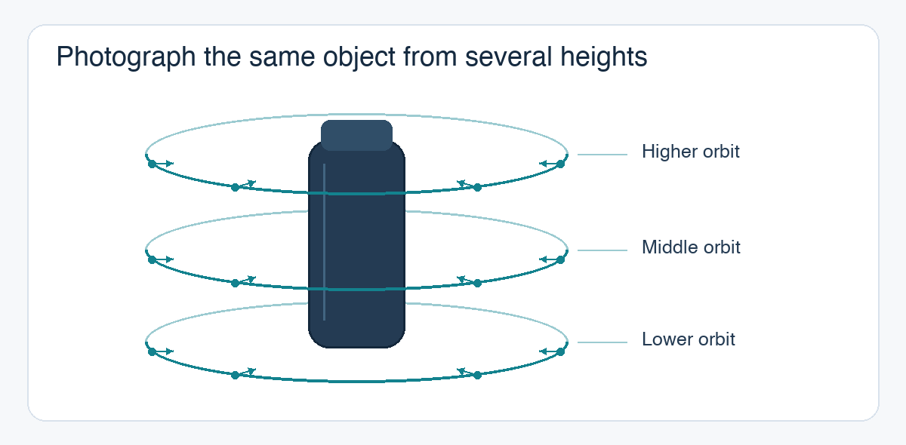
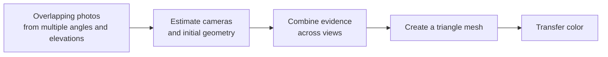
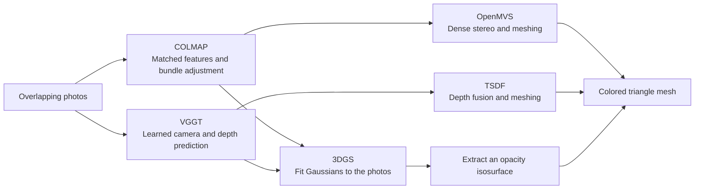
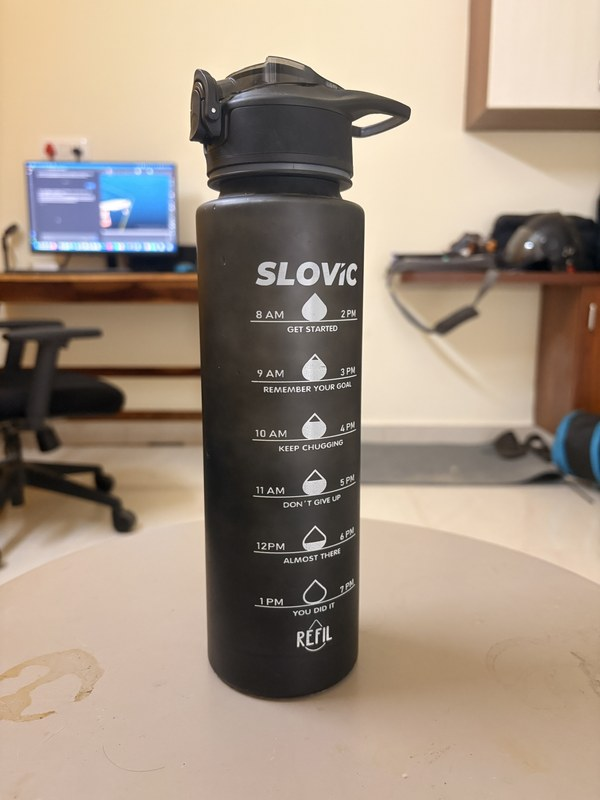
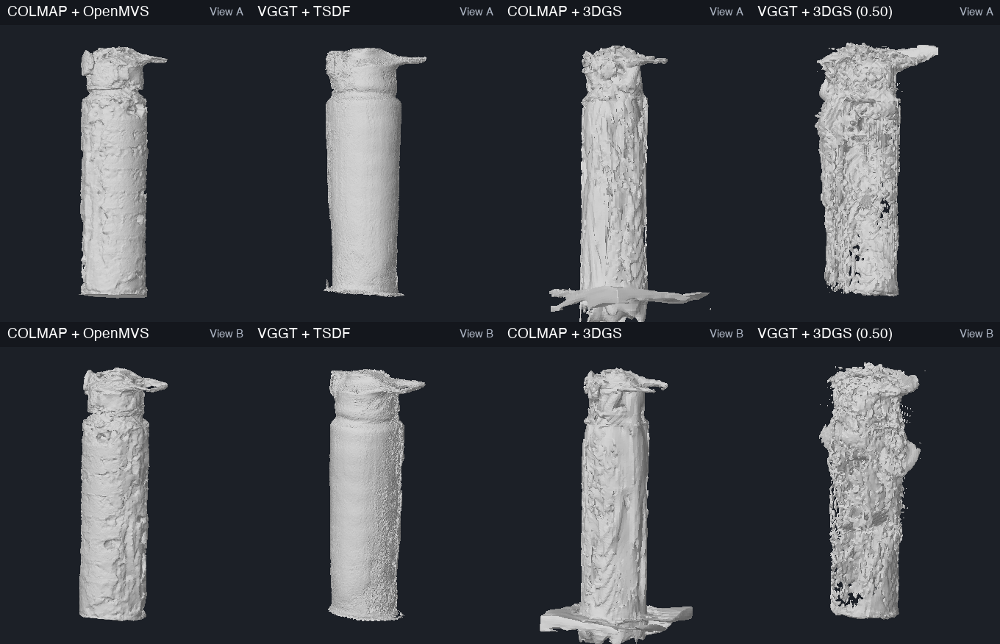

# 3D Reconstruction from Images — A Comparative Study

How do overlapping photographs become a 3D surface? This study compares four approaches using the same photo capture of a Sipper bottle. Each approach ends in a **colored triangle mesh (GLB)**. The bottle’s cylindrical wall, printed markings, and projecting lid handle make it easy to spot rough surfaces, gaps, and lost details.

To run the four pipelines on your own photos, follow the [reconstruction quickstart](docs/quickstart.md).

## From photographs to a surface

*Redrawn from the notebook sketch. Move around the bottle at each height and keep neighboring views overlapping.*

Photographs taken around an object provide overlapping views of its features. Higher viewpoints reveal the lid and shoulder, while lower viewpoints reveal more of the wall and base rim. The reconstruction first needs a camera model for each view. **Intrinsics** describe how the lens projects onto the image. **Extrinsics** describe where the camera was and which way it pointed. With these parameters, a method can triangulate a point from multiple observations or place a pixel with known depth in 3D.

## The four techniques

### COLMAP + OpenMVS — Match features and triangulate

**Structure from motion (SfM).** COLMAP detects local features and describes the image patch around each one. It matches descriptors across views, then uses geometric verification to reject matches that disagree with the relative camera geometry. Multiple observations of the same feature form a track. Triangulation finds the 3D point that best agrees with the viewing rays, and bundle adjustment jointly refines the cameras and points by minimizing reprojection error. [COLMAP tutorial](https://colmap.github.io/tutorial)

**Multi-view stereo (MVS).** With the camera geometry established, OpenMVS estimates depth over many more pixels. A candidate depth places a pixel in 3D, where it can be projected into neighboring views to check whether the surrounding patches agree. Consistent depth estimates are fused into a dense cloud. OpenMVS builds a triangle surface and projects colors from suitable views into a texture atlas. On the Sipper, the dark wall offers few distinct patches, and reflections shift as the camera moves. Both make stereo correspondence harder. [OpenMVS workflow](https://github.com/cdcseacave/openMVS/wiki/Usage)

### VGGT + TSDF — Predict depth and fuse it

**Learned multi-view geometry.** VGGT represents the images as tokens and alternates attention within individual views and across the image set. Its camera head predicts the camera parameters, while its depth head estimates per-pixel depth and confidence. The resulting depth maps describe the visible surface from each camera. Using predicted intrinsics and poses, the same depth pixels can also be placed in a common 3D frame. [VGGT paper](https://openaccess.thecvf.com/content/CVPR2025/papers/Wang_VGGT_Visual_Geometry_Grounded_Transformer_CVPR_2025_paper.pdf)

**Volumetric fusion.** To update a voxel, a truncated signed distance field (TSDF) projects it into a depth map and compares its depth with the observed depth at that pixel. The difference is signed according to which side of the observation the voxel lies on. Nearby measurements accumulate across views, with the truncation band limiting the influence of distant observations. Where views place the bottle wall at similar depths, their measurements support a common zero crossing. Marching cubes turns that crossing into triangles, and photo projection adds the texture. [Volumetric fusion paper](https://graphics.stanford.edu/papers/volrange/paper_1_level/gamma-corrected/paper.html)

### COLMAP + 3DGS and VGGT + 3DGS — Fit a scene that can be rendered

**Two ways to initialize the same representation.**

| Method | Cameras and initial Gaussian centers |
|---|---|
| COLMAP + 3DGS | Camera poses come from bundle-adjusted SfM. Centers start at 3D points triangulated from tracks. |
| VGGT + 3DGS | Camera poses come from VGGT. Centers start at 3D points unprojected from confident depth pixels inside the object masks. |

**Differentiable splatting.** Each 3D Gaussian has a center, oriented extent, opacity, and color coefficients. The renderer projects it to an elliptical footprint on the image, then blends these footprints in depth order. Because the renderer is differentiable, errors between rendered and source photos can update the Gaussian parameters. The two approaches therefore share the same visual fitting principle even though their starting geometry comes from different evidence. [Original 3DGS paper](https://repo-sam.inria.fr/fungraph/3d-gaussian-splatting/) · [Brush](https://github.com/ArthurBrussee/brush)

**Surface extraction.** For the common GLB output, the comparison samples the accumulated opacity of nearby Gaussians on a 3D grid. Marching cubes extracts the surface where opacity reaches the chosen threshold, and base Gaussian colors are transferred to vertices. Image rendering composites opacity along a ray, so a group of translucent Gaussians can cover the bottle wall in the image while individual locations in 3D fall below the mesh threshold. That helps explain why the splat renders look more complete than the extracted meshes. [Mesh extractor](extract_splat_mesh.py)

## What the results look like

*The actual Sipper bottle in one of the input photographs.*

The gray renders use approximately aligned meshes and matched viewpoints so the silhouette and surface are easy to compare. The [color comparison](docs/figures/sipper-appearance-selected.png) shows how the textures and vertex colors look on those surfaces.

| Technique | What stands out |
|---|---|
| **COLMAP + OpenMVS** | The bottle is recognizable and mostly continuous. The wall is lumpy and the cap is coarse. |
| **VGGT + TSDF** | The smoothest, most continuous wall and the most consistent silhouette. Some roughness remains around the cap and base. |
| **COLMAP + 3DGS** | Much of the wall is intact, with vertical ridges and a piece of tabletop attached to the base. |
| **VGGT + 3DGS** | The selected 0.50-opacity mesh shows a recognizable bottle with gaps in the lower wall and excess geometry around the shoulder. |

The [splat-to-mesh comparison](docs/figures/sipper-splats-vs-mesh.png) shows why the output format matters. The VGGT splats render a nearly continuous wall with visible printed markings, while the earlier 0.65-opacity mesh in that figure breaks apart in the same areas. The [opacity sweep](docs/figures/sipper-opacity-sweep.png) shows how the selected 0.50 mesh trades some of those gaps for additional surface clutter.

## Summary

**VGGT + TSDF gave the cleanest surface in this capture.** Fusing depth across views produced a more continuous bottle wall than extracting a surface from either Gaussian model. COLMAP + OpenMVS also recovered an intact shape, with more visible surface noise. The Gaussian models retained recognizable shape and markings in the rendered views, while their exported meshes showed holes, ridges, or background geometry. These observations are based on the appearance of the Sipper outputs in matched views. Absolute surface accuracy would require an independent reference.
