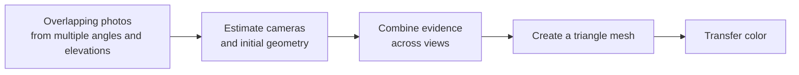
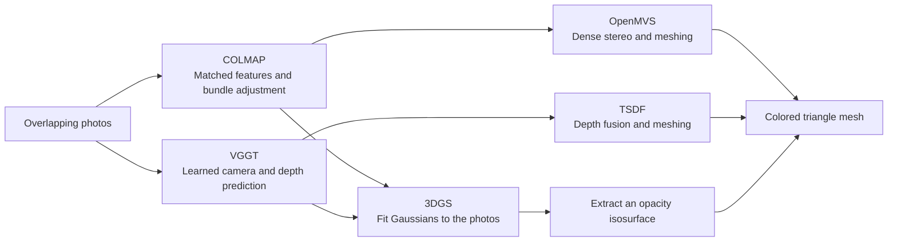

# 3D Reconstruction from Images — A Comparative Study

How do overlapping photographs become a 3D surface? This study compares four approaches using the same photo capture of a Sipper bottle. Each approach ends in a **colored triangle mesh (GLB)**. The bottle’s cylindrical wall, printed markings, and projecting lid handle make it easy to spot rough surfaces, gaps, and lost details.

## From photographs to a surface

Photographs taken around an object provide overlapping views of its features. Higher viewpoints reveal the lid and shoulder, while lower viewpoints reveal more of the wall and base rim. The reconstruction first needs a camera model for each view. **Intrinsics** describe how the lens projects onto the image. **Extrinsics** describe where the camera was and which way it pointed. With these parameters, a method can triangulate a point from multiple observations or place a pixel with known depth in 3D.

## The four techniques

### COLMAP + OpenMVS — Match features and triangulate

COLMAP finds corresponding features in overlapping photos. It triangulates those matches into a sparse 3D point cloud and jointly refines the cameras and points through **bundle adjustment**. OpenMVS uses the recovered cameras to estimate depth across more pixels, fuses those depths into a dense cloud, builds a mesh, and projects photo colors into a texture atlas. Clear features help establish cameras and depth. Smooth walls and reflections that change with the viewpoint make matching harder.

### VGGT + TSDF — Predict depth and fuse it

VGGT uses attention within and across the photos to predict cameras, depth, and confidence. A **truncated signed distance field (TSDF)** combines the predicted depths on a 3D grid. Each view contributes an estimate of how far a voxel is from the nearby surface and on which side it lies. Where the views agree, the combined field crosses zero consistently. That zero crossing becomes a triangle mesh, and the source photos supply its texture.

### COLMAP + 3DGS and VGGT + 3DGS — Fit a scene that can be rendered

Both methods start with camera estimates and seed points. COLMAP triangulates its seeds from image matches. VGGT supplies seeds by unprojecting predicted depths. **3D Gaussian Splatting (3DGS)** represents the scene with overlapping, translucent ellipsoids. A trainer renders the Gaussians from the input viewpoints and adjusts their positions, shapes, opacity, and color to match the photos.

To produce a GLB, the comparison extracts a surface at a chosen level in the Gaussian opacity field and colors its vertices. Several Gaussians can blend into a convincing bottle wall in a rendered image even when the extracted surface has holes. Lowering the opacity cutoff can fill some gaps while also including stray geometry.

## What the results look like

The gray renders use approximately aligned meshes and matched viewpoints so the silhouette and surface are easy to compare. The [color comparison](docs/figures/sipper-appearance-selected.png) shows how the textures and vertex colors look on those surfaces.

| Technique | What stands out | Mesh |
|---|---|---|
| **COLMAP + OpenMVS** | The bottle is recognizable and mostly continuous. The wall is lumpy and the cap is coarse. | [GLB](results/first-capture/colmap-openmvs/mesh.glb) |
| **VGGT + TSDF** | The smoothest, most continuous wall and the most consistent silhouette. Some roughness remains around the cap and base. | [GLB](results/first-capture/vggt-tsdf/mesh.glb) |
| **COLMAP + 3DGS** | Much of the wall is intact, with vertical ridges and a piece of tabletop attached to the base. | [GLB](results/first-capture/colmap-3dgs/mesh.glb) |
| **VGGT + 3DGS** | The selected 0.50-opacity mesh shows a recognizable bottle with gaps in the lower wall and excess geometry around the shoulder. | [GLB](results/first-capture/vggt-3dgs-unpadded/mesh-level-0.5.glb) |

The [splat-to-mesh comparison](docs/figures/sipper-splats-vs-mesh.png) shows why the output format matters. The VGGT splats render a nearly continuous wall with visible printed markings, while the earlier 0.65-opacity mesh in that figure breaks apart in the same areas. The [opacity sweep](docs/figures/sipper-opacity-sweep.png) shows how the selected 0.50 mesh trades some of those gaps for additional surface clutter.

## Summary

**VGGT + TSDF gave the cleanest surface in this capture.** Fusing depth across views produced a more continuous bottle wall than extracting a surface from either Gaussian model. COLMAP + OpenMVS also recovered an intact shape, with more visible surface noise. The Gaussian models retained recognizable shape and markings in the rendered views, while their exported meshes showed holes, ridges, or background geometry. These observations are based on the appearance of the Sipper outputs in matched views. Absolute surface accuracy would require an independent reference.
