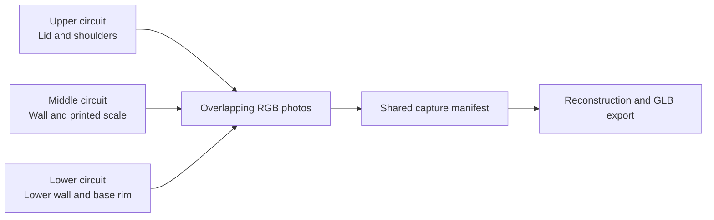
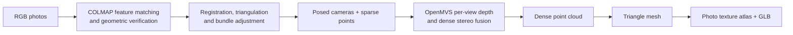
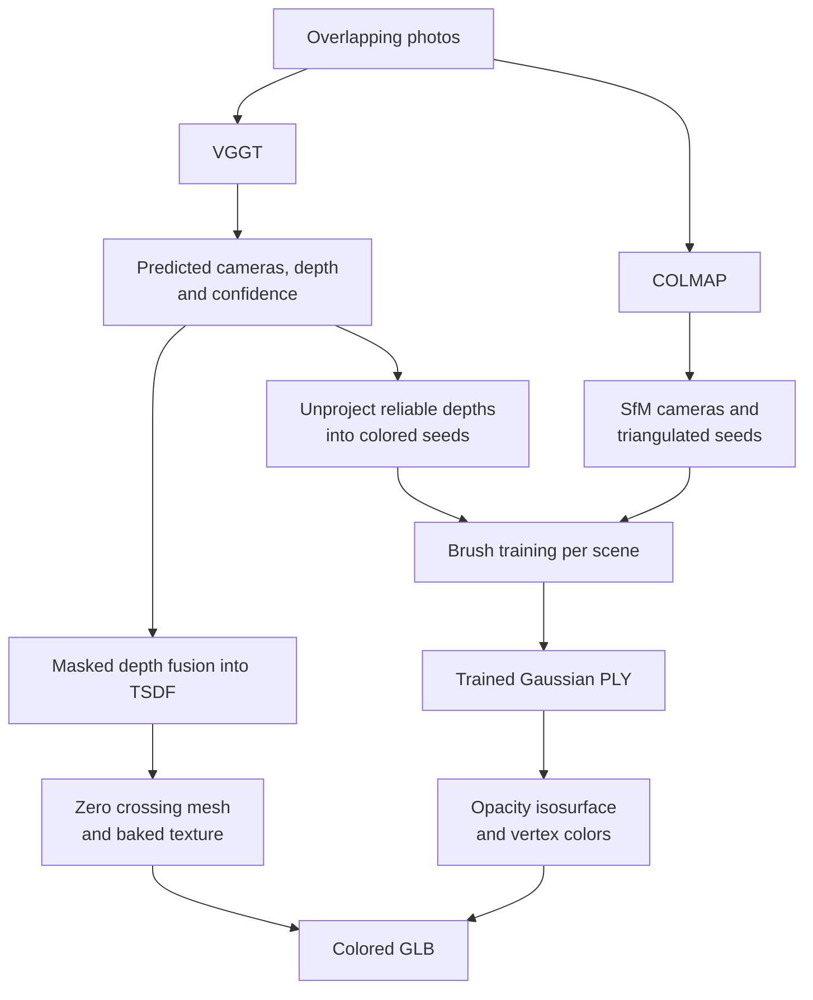
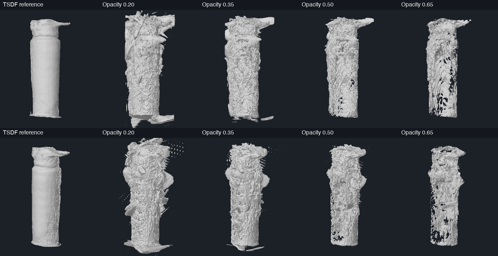
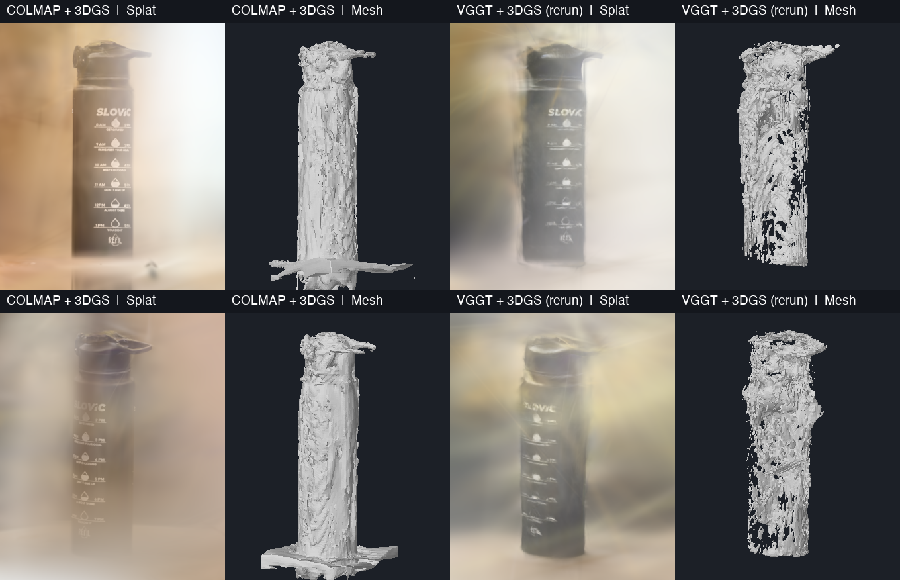

# 3D Reconstruction from Images — A Comparative Study

The study compares four routes from overlapping RGB photographs to a colored triangle mesh. The Sipper bottle is the test object. Its dark cylindrical wall, printed scale, projecting cap handle, and visible tabletop give us specific regions to inspect for holes, surface noise, distorted details, and background geometry.

## 1. Inputs and target output

Reconstruct a colored surface from overlapping photographs of an object. Capture a full circuit around the object at more than one elevation, with enough overlap to track features across adjacent views. Record camera settings when available and note any surfaces the camera could not see.

For an object like this bottle, vary both **azimuth** (position around the object) and **elevation** (height and tilt of the camera). Neighboring views need overlap so they can observe the same features. Elevated views add coverage of the lid and shoulder, while lower views add coverage near the base. A surface hidden by the supporting table has no direct photographic observation.

The Sipper pilot starts from [226 source photos](results/first-capture/capture.json). The two direct mesh pipelines used the same 99 selected views. COLMAP registered 96 of those views. Both Gaussian training runs use [those same 96 filenames](results/first-capture/gaussian_views.txt), with VGGT predictions cached from the 99-view set.

The common output is a **colored triangle mesh in GLB**. The direct mesh pipelines use texture atlases. The Gaussian meshes store vertex colors derived from the splats.

To register another capture, place the JPG, JPEG, or PNG files in [data/images](data/images) and run `python3 prepare_capture.py <run-name>`. This records the ordered filenames and SHA-256 fingerprints in `capture.json` and prepares result folders.

## 2. Fundamental reconstruction stages

| Stage | Purpose |
|---|---|
| Recover camera poses | Estimate where each photo was taken and the intrinsics needed to project between image and scene coordinates. |
| Create initial 3D geometry | Triangulate matched features or predict per-view depth and unproject it. |
| Aggregate geometry | Combine evidence across views into dense points, a signed-distance field, or a fitted Gaussian scene. |
| Create a surface | Extract a triangle mesh from the resulting geometry. |
| Add appearance | Project photos into a texture atlas or assign colors to mesh vertices. |

**Intrinsics** include focal length and principal point in pixel coordinates. **Extrinsics** give the camera rotation and translation relative to the scene. Together they let a method project a 3D point onto an image. They also let it take a pixel with a known depth and recover a 3D point. A resize, crop, or pad changes the intrinsics because it changes where rays land in pixel coordinates.

The five stages describe the information each pipeline needs. COLMAP alternates camera registration, triangulation, and refinement. VGGT predicts cameras and depth jointly. The Gaussian trainer optimizes geometry and appearance together and produces a triangle surface only after extraction.

## 3. Classical method and observed challenges

**COLMAP → OpenMVS.** COLMAP detects and matches image features, verifies the matches geometrically, and registers cameras. It triangulates feature tracks into a sparse cloud and uses bundle adjustment to refine points and cameras. OpenMVS estimates per-view stereo depths, fuses them into a dense cloud, reconstructs the mesh, and projects image colors into an atlas.

Triangulation finds a 3D point from rays through corresponding image features. Bundle adjustment refines that point and the camera parameters by reducing the distance between the observed and projected feature positions. OpenMVS then uses the registered views to estimate depth at many more pixels. Poor stereo depth can carry through fusion into bumps or depressions on the mesh.

The [pilot mesh](results/first-capture/colmap-openmvs/mesh.glb) has a recognizable, mostly continuous silhouette. Its wall is lumpy and its cap is coarse. The dark wall and changing highlights are plausible causes of stereo depth errors. The baked atlas also contains false-color patches that affect appearance independently of the surface.

## 4. Learned and Gaussian pipelines

| Pipeline | Stages and intermediate outputs | Selected GLB |
|---|---|---|
| **VGGT → TSDF** | VGGT uses attention within and across images to predict camera parameters, depth, and confidence. Masked depth maps and poses feed a truncated signed-distance field. Extract the zero crossing, then bake photo colors into a texture atlas. | [VGGT + TSDF mesh](results/first-capture/vggt-tsdf/mesh.glb) |
| **COLMAP → 3DGS** | COLMAP supplies cameras, undistorted RGB images, and triangulated seed points. Brush fits Gaussian positions, shapes, opacity, and appearance to the training views. Extract a mesh from the fitted opacity field. | [COLMAP + 3DGS mesh](results/first-capture/colmap-3dgs/mesh.glb) |
| **VGGT → 3DGS** | VGGT supplies cameras and seed points unprojected from masked, confidence-filtered depth. Brush fits the Gaussians to the original photos resized without padding. Extract a mesh from the fitted opacity field. | [VGGT + 3DGS mesh at 0.50 opacity](results/first-capture/vggt-3dgs-unpadded/mesh-level-0.5.glb) |

### VGGT → TSDF

VGGT exchanges information across the input images through attention and predicts camera parameters, depth maps, and confidence. TSDF fusion projects voxels into the posed depth maps and accumulates signed distances near the observed surface. Where multiple views agree on the bottle wall, their measurements reinforce the same zero crossing. Marching cubes converts that crossing into triangles, and photo projection supplies appearance. The per-view depths remain part of the reconstruction through the fusion step.

### Gaussian optimization

Both Gaussian runs start with 3D seed points. An individual Gaussian has a center, extent, orientation, opacity, and color coefficients. Brush projects and blends the Gaussians to render training views, then updates their parameters to reduce the image error. VGGT depth contributes seed points in the hybrid run. The training objective is driven by the rendered images, so several translucent Gaussians can account for a visible patch without forming a continuous 3D surface there.

Both Gaussian runs used Brush 0.3.0 for 3,000 steps, a maximum image dimension of 768 pixels, and a cap of 250,000 splats. [The shared extractor](extract_splat_mesh.py) composites Gaussian opacity on a voxel grid, extracts an isosurface with marching cubes, and assigns vertex colors from the constant spherical-harmonic coefficients. It uses 128 samples along the longest axis. The pilot crop is taken from the corresponding direct mesh in each pipeline's native frame, giving different crop bounds and voxel spacings. The COLMAP mesh uses an opacity threshold of 0.35. The selected VGGT mesh uses 0.50.

## 5. Comparison and results

The meshes were approximately aligned by corresponding camera centers and rendered at the same scale from two viewpoints. For appearance, see the [color comparison](docs/figures/sipper-appearance-selected.png). The TSDF preview normalizes the atlas coordinates, which are stored in pixels in the pilot GLB.

| Method | Observed surface quality |
|---|---|
| COLMAP + OpenMVS | Mostly continuous bottle, with a lumpy wall and coarse cap. |
| VGGT + TSDF | Cleanest wall and most consistent silhouette. Some roughness remains near the cap and base. |
| COLMAP + 3DGS | Mostly continuous wall with vertical ridges and table geometry attached at the base. |
| VGGT + 3DGS at 0.50 | Fewer gaps than the 0.65 extraction. The wall is still rough and partly open, with excess geometry around the shoulder. |

The gray renders expose geometry independently of the color exports. The second view makes the difference between the Gaussian meshes particularly clear. COLMAP + 3DGS roughly preserves the wall and retains part of the table. VGGT + 3DGS at 0.50 removes much of the base clutter but still leaves gaps near the lower wall and excess geometry around the shoulder. The TSDF result is more continuous across both views.

The two Gaussian runs change camera estimation, seeds, and image preparation together. Their mesh extraction also uses different crops and physical voxel spacings. The comparison ranks complete pipeline outputs for this capture and does not isolate the effect of VGGT initialization.

For a quantitative comparison, align to a common frame and scale, apply a shared object crop, and report surface accuracy and completeness against an independent scan or measured dimensions where available. Use matched views to assess visible coverage, holes, and appearance. Include mesh extraction in end-to-end time. This pilot has no independent ground-truth surface, and its results are primarily visual.

## 6. Ablations and future work

- **Training image preparation.** The original VGGT + 3DGS images had black padding covering about 24% of each frame. [The revised exporter](prepare_vggt_splats.py) uses EXIF-corrected original photos and adjusts intrinsics for the crop and resize. The rerun held poses, seeds, and training budget fixed. Padding, image resolution, and resampling changed together.
- **Opacity threshold.** The [0.20–0.65 sweep](docs/figures/sipper-opacity-sweep.png) showed a trade-off between holes and stray geometry. At 0.50, 89% of sampled TSDF surface points were within two extraction voxels of the Gaussian mesh, and 72% of sampled Gaussian mesh points were within that distance of TSDF. This measures agreement with the TSDF output. The TSDF mesh also supplied the extraction crop bounds.
- **Splats versus mesh.** The [splat diagnostic](docs/figures/sipper-splats-vs-mesh.png) shows that the bottle wall looks more continuous when rendering the saved Gaussians directly than in the earlier 0.65 mesh. The splat preview uses base colors and orthographic projection.
- **Next experiments.** Render posed depth from both Gaussian models and fuse it with the same settings. For an initialization ablation, match the training image preparation and extraction crop across both runs. Test view count and elevation coverage separately.

### Extraction results

| Opacity threshold | Triangles | Extracted surface near TSDF | TSDF surface near extracted mesh |
|---:|---:|---:|---:|
| 0.20 | 123,578 | 39.0% | 63.8% |
| 0.35 | 91,836 | 60.9% | 81.5% |
| **0.50 (selected)** | **73,118** | **72.3%** | **89.1%** |
| 0.65 | 54,856 | 79.2% | 88.0% |

Both columns measure the fraction of sampled surface points within two voxels of the other surface. The 0.65 setting keeps a greater fraction of sampled surface points close to the TSDF surface, while 0.50 leaves fewer visible gaps. At 0.20, additional geometry around the cap, shoulder, and base makes the reconstructed shape harder to distinguish.

This diagnostic uses the earlier 0.65 extraction. Both splat previews show the printed scale and a continuous-looking bottle wall. In the VGGT preview, areas that appear filled in projection break apart in the extracted mesh. That implicates opacity thresholding in the visible holes. The splat preview also shows smearing near the cap, so extraction is only part of the performance gap. The previews use the saved Gaussians' base colors and do not measure held-out image quality.

## 7. Summary

VGGT + TSDF produced the most continuous mesh for this Sipper capture. COLMAP + OpenMVS recovered an intact but rougher surface. Both Gaussian runs render a recognizable bottle, yet their extracted meshes retain artifacts. The 0.50 extraction is the chosen VGGT + 3DGS pilot reference, and the ranking applies to these exported meshes under the pilot settings.

For a study centered on usable surfaces, the present result favors depth fusion. The Gaussian experiments show how much of the visual signal can survive in a render even when the extracted surface is incomplete. A comparison of depth-fused Gaussian meshes against the opacity meshes would test whether the extraction method can close that gap using the same trained models.
